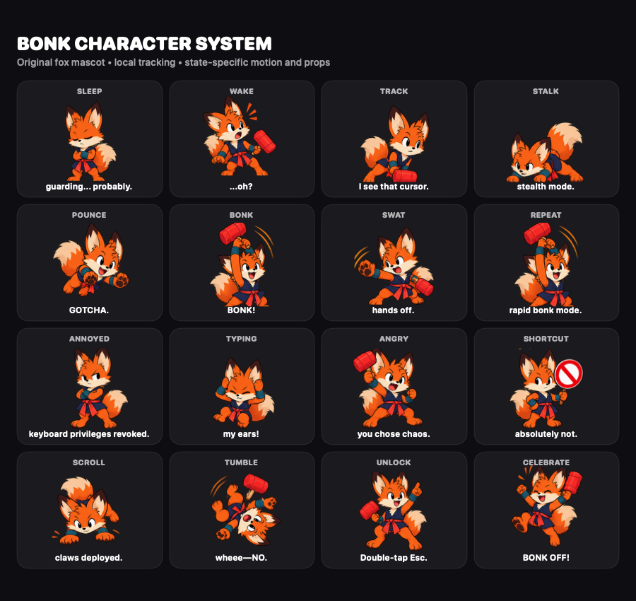

# Features and character behavior

Bonk keeps the desktop visible and the Mac awake while blocking unwanted keyboard, mouse, and trackpad input. It is useful for dashboards, demos, long-running tasks, keyboard cleaning, curious pets, and any moment when the screen should stay on but hands should stay off.

Bonk is not a replacement for the macOS Lock Screen. Anything already visible remains visible. Bonk is early-stage software; review the code and understand its Accessibility permission before relying on it.

## Highlights

- Native SwiftUI and AppKit menu-bar app with no game engine or web runtime
- Accessibility-backed global input suppression with fail-open cleanup
- Transparent protection across every connected display
- Instant 120 Hz local virtual-cursor tracking, independent of network decisions
- Typing-speed energy that grows the fox up to a safe visual limit, then counts down smoothly
- On-device responses shaped by movement gestures and typing pace
- Four-second reading windows and a resting fox after 20 seconds of inactivity
- Optional Jev direction for reaction, tone, pacing, flourish, intensity, and dialogue selection
- More than 600 curated dialogue options with context filtering and anti-repetition
- Double Escape as the only guarded-input path to macOS owner authentication
- Two-second Jev quiet-period scheduling to avoid jitter during input bursts
- Strict schema, allowlist, confidence, freshness, and bounds validation around every Jev result
- Complete deterministic offline reaction engine
- Keychain storage for the optional Jev API key
- Reproducible character assets and screenshot tooling
- Three bonk modes: classic fox, screen-off, and an agents away-screen
- Opt-in intrusion camera that photographs genuine failed unlock attempts
- Local process-name scan that lists the agents still running while you are away

## Bonk modes

Choose what Bonk shows while guarding in **Settings → Bonk mode**. The mode is fixed for a guard session; stop Bonk to change it. Input blocking and double-Escape owner unlock work identically in every mode.

- **Classic fox** — the original transparent overlay with the reacting fox; the desktop stays visible.
- **Screen off** — an opaque black cover on every display, so the Mac looks powered off. The fox, its sounds, and Jev stay idle.
- **Agents away-screen** — a minimal black screen on every display showing a lock, an `AWAY` lockup, a "running agents" pill, a live waveform, and the clock. It lists the processes that match your configured agent names, updating as they start and stop, so a passerby sees that work is in progress and you will be back.

## Intrusion camera

Enable **Settings → Intrusion camera** to photograph whoever fails to unlock the Mac while it is bonked. Bonk asks for camera access when you turn it on. It captures a single photo **only** on a genuine failed unlock (a wrong password or biometric) — never on a cancelled prompt or a successful unlock — and saves it to `~/Pictures/Bonk/`. When you unlock, the menu shows how many attempts were captured and reveals the folder. This works in every mode and never delays unlocking.

## Character reactions

Mouse movement, clicks, scrolling, typing, and shortcut attempts produce different poses and motion. The virtual cursor follows movement immediately. While a message is within its four-second reading window, the fox stays in place so the bubble remains readable. Clicks and keys change its pose immediately while text waits; movement and scrolling respect the current reaction window. After 20 seconds without input, the fox rests and hides its bubble; the next input wakes it. Faster typing charges the fox from `1.0×` up to `1.65×`; after typing stops, it eases back to normal over four seconds.

Input attempts never open Touch ID. To unlock, press `Esc` twice within 650 milliseconds; holding the key does not count.
